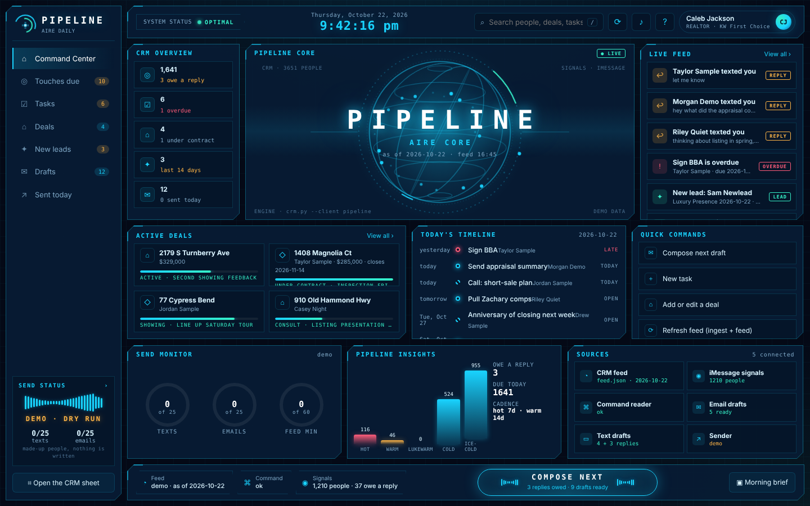

# Pipeline (Caleb's daily tool)

One screen, Jarvis style, that shows what the CRM engine in `aire/crm/` already computed and sends Caleb's actions back through `crm.py`. Rebuilt from the ground up on 2026-10-22 by Claude Code, replacing the Codex-built SwiftUI app that lived at `~/Documents/Codex/2026-10-19/task-3/PipelinePanel` on the Mac. Nothing else is to be built beside it: improve Pipeline, never a parallel dashboard (Caleb, 2026-10-19).



## What it is

- `app.py`: a Python server with no dependencies beyond the standard library. It reads the feed and the draft queues, serves the screen on `http://127.0.0.1:4747/`, and is the only thing that calls `crm.py`. It keeps the send log, runs the Do Not Contact check and enforces the daily cap.
- `static/`: the screen. Plain HTML, CSS and JavaScript, no build step, no CDN, works offline. Boot sequence, a particle core that reacts to the voice, gauges, staggered panel reveals, a compose drawer that slides in from the right. `core.js` draws the core, `voice.js` is the voice loop, `app.js` is everything else.
- `predraft.py`: the step `aire/crm/refresh_feed.sh` runs after every feed rebuild. It turns `feed.json` into the text and email drafts the compose box shows, using the one drafting library in `aire/follow-up/`.
- `fixtures/`: made-up people for `--demo`, so the app can be tried and screenshotted without the real CRM.
- `launchd/` and `install.sh`: start the server at login and put a Pipeline app in the Dock that opens the screen as its own window, with the Pipeline mark as its icon (`static/logo.svg`, rendered to `static/logo-1024.png`; `install.sh` builds the `.icns` with the Mac's `sips` and `iconutil`).

## Build and run

There is no build. On the Mac, from `~/Caleb-s-Agents`:

```
# try it with made-up people first
python3 aire/pipeline-app/app.py --demo

# the real feed (rebuild it first if it is stale)
sh aire/crm/refresh_feed.sh
~/.aire/venv/bin/python aire/pipeline-app/app.py
```

The browser opens on `http://127.0.0.1:4747/`. Stop it with Ctrl-C.

To have it there every morning:

```
sh aire/pipeline-app/install.sh
```

That loads the LaunchAgent `org.calebjackson.aire.pipeline` (server at login, kept alive, log in `~/.aire/logs/pipeline.log`) and creates `~/Applications/Pipeline.app`, which opens the screen in a Chrome app window. Drag it to the Dock. `sh aire/pipeline-app/install.sh --remove` takes both away.

Checks: `python3 aire/pipeline-app/ui_test.py` renders every page (nothing hides behind a sitewide switch, only the Bank page hides its own figures, no developer text, one lead count, one deal source, nav and keys agree). `python3 aire/pipeline-app/app.py --test` runs the offline checks (demo writes, the three send gates, the HTTP layer, the `crm.py` contract). `python3 aire/pipeline-app/bridge.py --test` checks the Grok bridge. The suite sets its own clock, so it passes at any hour.

### Environment

| Variable | Default | What it does |
|---|---|---|
| `PIPELINE_PORT` | `4747` | Port on 127.0.0.1. The server never listens on any other interface. |
| `PIPELINE_PYTHON` | `~/.aire/venv/bin/python` if it exists | Python used to run `crm.py`. That venv has the Sheets credentials and Full Disk Access, so the app itself needs neither. Any Python 3.10 or newer works, built with uv or Homebrew. Full Disk Access goes on the real binary, not the venv symlink: `readlink -f ~/.aire/venv/bin/python` prints it (for uv, under `~/.local/share/uv/python/`). |
| `PIPELINE_SENDER` | `dry` | `live` sends for real: texts through Messages, email through Gmail. Anything else logs the send and sends nothing. The screen says which mode it is in. |
| `PIPELINE_LIVE_HOST` | none | The one Mac allowed to send (Caleb, 2026-11-10: the Mac mini). `live` only works when this matches the Mac's own name (`hostname -s`). Unset or a different Mac means dry, with a line on screen saying why. Goes in `~/.aire/pipeline.env`. |
| `PIPELINE_SELF_ALERT` | `on` | `off` stops the new lead alert to Caleb's own number. It only ever runs on the `PIPELINE_LIVE_HOST` Mac. |
| `PIPELINE_MAX_TEXTS`, `PIPELINE_MAX_EMAILS` | `25` | Daily caps, counted from `out/send-log.json` in Central time. |

`install.sh` writes these into the LaunchAgent with `PIPELINE_SENDER=dry`. Flip it to `live` in `~/Library/LaunchAgents/org.calebjackson.aire.pipeline.plist` and reload when you are ready to send from the app.

## What the app reads

All paths relative to `aire/`. Every one of these files is git-ignored and stays on the Mac: they hold client names, phones and message text.

| File | Written by | What the app shows from it |
|---|---|---|
| `crm/feed.json` | `crm/refresh_feed.sh` (LaunchAgent `org.calebjackson.aire.feed`, every 15 minutes and at login), which runs `crm.py feed --signals ../enrichment/out/imessage-signals.json` | Touches due (owes-a-reply first, then hot, then signal score, then longest silence), open tasks, live deals, new leads of the last 14 days, counts, `header_ok`. Spec: `crm/FEED.md`. |
| `follow-up/out/text-queue.json` | `pipeline-app/predraft.py` (run by `refresh_feed.sh`), or `follow-up/followups.py --queue` | Text drafts in the compose box, one per phone-only person who is due. `reply_first` entries carry the person's last three texts instead of a template. |
| `follow-up/out/email-queue.json` | same | Email drafts in the compose box for people with an email. |
| `map-crm/farms.local.json` | the Map page (DRAW FARM) | The farms Caleb drew. Saving one rebuilds the feed so `feed.map.farms` carries the counts; the screen counts them itself in the meantime. |
| `map-crm/cache/dismissed.json` | the Market Monitor (Dismiss) | Ids hidden from the Market Monitor. Nothing in the sheet changes. |
| `map-crm/out/call-list-<date>.csv`, `postcards-<date>.csv` | the Map page and the Market Monitor | Lists out. A call list row needs a phone, a postcard row needs an address, nobody is added twice in a day. |
| `command-reader/out/status.json` | `command-reader/command_reader.py` (LaunchAgent `org.calebjackson.aire.command`, every 30 minutes) | `{"at", "state", "detail"}`. On `login needed` or `layout changed` the status chip turns amber, the bell counts it and the Sources panel names it. |

When `feed.json` says `header_ok: false`, the app shows the HEADER CHANGED stop screen and nothing else, because the Contacts header lost a column the engine needs (`crm/FEED.md`). When `feed.json` is missing it says so and offers the refresh. When it is older than an hour the feed gauge turns red.

## What the app sends back

Every write is one shell call to `aire/crm/crm.py` with `--json --client pipeline` (verified in `app.py`, class `EngineCRM`). The engine prints exactly one JSON object (`{"ok": true, "result": ...}` or `{"ok": false, "error": ...}`), applies the write gates (person_id must exist, Do_Not_Contact only ever to YES, Command_ID never written) and logs the write to `audit.jsonl` and the Connector Log tab with `pipeline` in the Client column. A refused write shows as a red toast with the engine's reason. Nothing is retried on its own.

| In the app | Command |
|---|---|
| "Touched" on a person, and after every real send | `crm.py --json --client pipeline touch <person_id> "<what happened>"` |
| "Done" on a task with a `task_id` | `crm.py --json --client pipeline done <task_id>` |
| "Done" on a Next_Action row (no `task_id`) | `crm.py sync-tasks`, then `crm.py feed`, then `done` on the id the fresh feed carries |
| New task (Quick command, or ＋ Task on a person) | `crm.py --json --client pipeline task <person_id> "<task>" --due YYYY-MM-DD` |
| Add or edit a deal | `crm.py --json --client pipeline deal "<street>" --stage ... --price ... --close ... --next-step ... --event ... --expect <current stage> [--create --side buyer|seller]` |
| Note on a person | `crm.py --json --client pipeline note <person_id> "<text>"` |
| Do Not Contact (one way, asks for a reason) | `crm.py --json --client pipeline dnc <person_id> --reason "<why>"` |
| Refresh | `sh crm/refresh_feed.sh` on the Mac (signals, feed, predrafts), `crm.py ingest` then `crm.py feed` elsewhere. Runs in the background; the screen reloads when it finishes. |

`stage` is wired in the server (`/api/stage`) but has no button yet: stage changes come through the deal editor or the sheet.

## Sending

Pipeline is the one sender (Caleb, 2026-10-20). Every send from the compose box goes through five gates in `app.py` `State.send()`, in this order, and stops at the first one that fails:

1. **Daily cap.** Texts and emails are counted separately from `out/send-log.json` for today, Central time. The 26th is refused and the toast says so.
2. **Do Not Contact.** A dry-run `touch` through the engine's own gate. The engine refuses a DNC person, so the send is refused with the engine's reason. No write happens.
3. **Text consent** (2026-11-10). A text is refused when the person's newest website form left the texting box unchecked. The feed lists those people as `no_text_consent`. Email still works for them. Someone with no form on file is not blocked.
4. **Quiet hours** (2026-11-10). Nothing goes between 8 pm and 8 am Central. The one exception is a text back to someone who texted last and is still waiting.
5. **Sender mode.** Only on the Mac named in `PIPELINE_LIVE_HOST`. `PIPELINE_SENDER=live` sends: a text through Messages (`osascript`, the body passed as an argument so quotes are safe), an email through the Gmail token in `aire/follow-up/` using that library's one send function. Any other value logs a `dry-run` entry and sends nothing.

After a real send the engine logs it with `touch`, so the person drops off tomorrow's list. The Sent today view and the Send monitor gauges read the same log. A person already in today's log is hidden from the queue.

### Hot and Warm, under Leads

Two pages indented under Leads in the menu (Caleb, 2026-11-10). Each lists the people `aire/crm/heat.py` scores hot (50 and up) or warm (30 to 49), hottest first, with the reasons in plain words and the heat number. A row has no buttons: the whole row is the click target and opens the person, by mouse or by Enter. Where the sheet's band disagrees the row says so. The lists fill themselves on every feed refresh. Nothing here writes to the sheet. The audit that led to it: `aire/enrichment/AUDIT-2026-11-10-temperature.md`.

### Grok bridge: calls and hard drafts

Contract: `CONTRACT-grok-bridge.md`. Code: `bridge.py` (28 offline checks, `python3 aire/pipeline-app/bridge.py --test`) and `State.bridge_job()` in `app.py`.

Where it shows on screen (2026-11-10): every card with a valid number and a CRM id has a **Call** button next to Text and Email. The message box has a Grok panel under the draft with two tabs, Call and Hard draft. **Grok calls** in the Today group of the menu lists every job, with the ones that need Caleb first and a count on the menu. Names, numbers, drafts and call summaries follow the privacy switch. On a phone the message box now fits the screen.

In the panel, type one line saying what the call or the draft has to do, then:

- **Ask Grok to call** posts a `call` job to Grok bot's webhook routine. Grok shows its own Call card in its chat. Nothing dials until Caleb taps that card, and the card lasts 30 minutes. So a call is two taps on purpose.
- **Ask Grok for a draft** posts a `hard_draft` job. When Grok's draft comes back it shows in the block with **Use this draft**, which fills the compose box. It goes out only through SEND and every send gate. Grok never sends a text or email.

Gates before a job leaves: Do Not Contact (the engine's own check), quiet hours for calls with no exception, a purpose from the short list (confirm a showing, appointment reminder, a callback they asked for, open the call then hand to Caleb), Grok's limits (10 calls in 24 hours, 4 to one number, United States numbers, no Washington or Illinois area codes, a script of 2,000 characters at most), and 10 hard drafts a day.

Results come back as one JSON file per job, named by `job_id`, in the folder `PIPELINE_BRIDGE_RESULTS`. Pipeline never listens on the internet. A finished call is logged once with `crm.py touch`. A card nobody tapped reads expired after 40 minutes and logs nothing. Jobs are kept in `out/bridge-log.json`, which stays on the Mac.

| Variable (in `~/.aire/pipeline.env`) | Default | What it does |
|---|---|---|
| `PIPELINE_CALLER` | `dry` | `live` posts jobs to Grok. Anything else logs the job and posts nothing. Only works on `PIPELINE_LIVE_HOST`. |
| `PIPELINE_GROK_WEBHOOK_URL` | none | The webhook URL from Grok's routine panel. Must be https. |
| `PIPELINE_GROK_AUTH_HEADER` | none | The Authorization header value from the routine panel, sent as is. |
| `PIPELINE_GROK_WEBHOOK_KEY` | none | Used only when no header value is set, sent as `Bearer <key>`. |
| `PIPELINE_TRANSFER_TO` | none | Caleb's own number, for the hand over on an assisted call. |
| `PIPELINE_BRIDGE_RESULTS` | `out/bridge` | The folder result files land in. Until the mini is registered with Grok this can point at the Google Drive for desktop copy of the Pipeline Bridge Results folder. |
| `PIPELINE_BRIDGE_WRITEBACK` | `drive` | `local` tells Grok to write results to `aire/pipeline-app/out/bridge` on the mini. |
| `PIPELINE_MAX_HARD_DRAFTS` | `10` | Hard drafts a day. |

Not verified: a real post to Grok's webhook. How Grok wants the key and header sent is taken from the routine panel's three values and has not been tried. The first live job tells.

### The Text button on a card

Every Touches due and New leads card with a phone on file has a **Text <first name>** button (Caleb, 2026-11-05: click a lead's Text button and the text goes from the app, with the card updating on its own). It opens the compose box set to text, with the queued draft if there is one. Nothing goes until Caleb presses SEND, and the send runs the same gates. A card with no phone keeps ✉ Compose.

After the send the drawer closes so the card is in view, and the card shows one line from the send log: `Texted 9:42 AM · delivered`, `· sent`, `· checking delivery`, `Text failed 9:42 AM · not delivered`, or `Dry run 9:42 AM · nothing sent`. The newest text in the last 30 days counts. While a live text is not confirmed yet, `last_texts()` in `app.py` reads `chat.db` again (read only) on every state read for 30 minutes after it went, writes a change back to `out/send-log.json` as `delivery`, and the screen asks for the state every 4 seconds until it settles, so the line flips on its own. An SMS that macOS never marks delivered stays at `sent`.

The touch in the AIRE CRM is written the moment the send succeeds, as before. KW Command does not get the text until Command has an API Pipeline can write to (DevHub application pending).

`followups.py --approve` stays a dry run unless `FOLLOWUP_SENDER=followups` is set on purpose, so nobody gets two messages from two places.

## Voice

Say **"hey Pipeline"** (or "hey Jarvis"), then a command. Pipeline answers out loud and moves the screen. Everything it says is read from the feed, so it never invents a number, and nothing is sent by voice.

| Say | It does |
|---|---|
| brief, morning, rundown | Reads the morning brief: replies owed, overdue tasks, new leads, live deals, drafts ready |
| who texted me, replies | Opens Touches due and reads who texted last and what the first one said |
| touches, who's due | Opens Touches due and reads the top three |
| tasks, overdue | Opens Tasks and reads the count and the first one |
| deals, closings | Opens Deals and reads the first three with stage and next step |
| leads | Opens New leads and reads them |
| compose, next draft | Opens the next draft in the compose box |
| refresh | Rebuilds the feed |
| status, anything wrong | Reads the attention list, or says all is fine |
| sent, log | Reads today's counts against the caps |
| stop, quiet | Stops talking |

How it works, all in the browser: Chrome's speech recognition listens (`webkitSpeechRecognition`, which sends audio to Google's speech service while the loop is on), `speechSynthesis` talks with a British voice when the Mac has one (Daniel), and the intents are plain word matching in `static/voice.js`. There is no LLM in the loop. Safari has no speech recognition, so use Chrome on the Mac; the Dock app from `install.sh` opens Chrome. Where there is no microphone the same commands can be typed in the sidebar's command box (`t`). The mic button (`v`) turns the loop on and off; after the wake word it stays awake for 25 seconds, so you can chain commands. The status chip shows LISTENING, THINKING or SPEAKING, the core fires streaks while it thinks, and the core panel shows the last thing heard and a telemetry ticker of what the app did.

### Claude Q&A and the ElevenLabs voice

Both are off until their key is present, and both cost money per call. Put the keys in `~/.aire/pipeline.env` (one `KEY=VALUE` per line, never in the repo, never in the LaunchAgent plist) and restart Pipeline:

```
ANTHROPIC_API_KEY=sk-ant-...
ELEVENLABS_API_KEY=...
# optional
PIPELINE_ASK_MODEL=claude-opus-5-5
ELEVENLABS_VOICE_ID=onwK4e9ZLuTAKqWW03F9
ELEVENLABS_MODEL=eleven_flash_v2_5
```

**Claude Q&A.** Anything the word-matching intents do not recognize goes to Claude, and "ask ..." forces it ("hey Pipeline, ask who is most likely to list this spring"). Claude gets a compact view of today: counts, the top 25 touches due with band, stage, next action and their last three texts, open tasks, live deals, new leads, today's send counts and the Command state. No phone numbers or emails are in it. The system prompt tells it to answer in two or three spoken sentences from that data only, never to invent a name or number, and never to promise to send anything. Model: `claude-opus-5-5` at low effort (quick spoken answers), with the server-side refusal fallback on, 400 output tokens max. Needs the `anthropic` package in Pipeline's Python, which the enrichment pass already uses. Each question is roughly 2,000 to 4,000 input tokens and under 100 output, so about a cent or two at the published Opus 5.5 prices. The Sources panel shows how many questions were asked and `out/voice-usage.json` keeps the token counts and a running cost estimate.

**ElevenLabs voice.** With `ELEVENLABS_API_KEY` set, everything Pipeline says goes through ElevenLabs text to speech (default voice Daniel, British, model `eleven_flash_v2_5` for low latency) and plays in the page. Without the key, or if a call fails, the browser's own voice speaks instead and the transcript line says so. Characters spoken are counted in the Sources panel; ElevenLabs bills by character on its plans.

**Privacy.** Names and last texts leave the Mac only while the Q&A step is on, to Anthropic, the same way the enrichment's Haiku pass already sends them. What Pipeline says (which can include names) goes to ElevenLabs only while that key is set. Chrome's speech recognition sends the microphone audio to Google's speech service while the loop is on. Set no key and none of that happens.

### Calls: ElevenLabs Speech Engine with Claude as the brain

The two modes above run in the browser. Speech Engine is the third mode and the one from the second reel: ElevenLabs does the listening and the talking over WebRTC (its own turn-taking, interruptions, a studio voice), and Pipeline's own server supplies the words. `speech_engine.py` is that server, written with the ElevenLabs Python SDK's transcript server protocol: ElevenLabs connects to it over WebSocket, sends the transcript with the full history each time you finish speaking, and streams Claude's reply back as text chunks that ElevenLabs turns into speech as they arrive. You can interrupt mid-sentence; the SDK cancels the in-flight answer.

Setup, once, on the Mac:

```
# 1. packages in Pipeline's Python
~/.aire/venv/bin/pip install elevenlabs anthropic

# 2. a public wss:// address for the transcript server (ngrok free tier works; keep this running)
ngrok http 3001          # copy the https host, for example abc123.ngrok.io

# 3. create the Speech Engine resource that points at it, and save its id to ~/.aire/pipeline.env
~/.aire/venv/bin/python aire/pipeline-app/speech_engine.py create --ws-url wss://abc123.ngrok.io/ws --save

# 4. run the transcript server (keep this running too)
~/.aire/venv/bin/python aire/pipeline-app/speech_engine.py serve
```

Then restart `app.py`. With `ELEVENLABS_API_KEY`, `ELEVENLABS_SPEECH_ENGINE_ID` and `ANTHROPIC_API_KEY` all in `~/.aire/pipeline.env`, the bottom pill reads CALL PIPELINE. Tap it: the browser asks `app.py` for a short-lived WebRTC token (`/api/voice/token`, minted with your key on the server, never in the page), loads the ElevenLabs client from the pinned CDN build, and starts the conversation. Pipeline greets you, then you just talk. The core follows the call (listening, speaking), the transcript shows both sides, and tap again hangs up. Conversations are capped at 20 minutes by the resource; ngrok's free host changes each restart, so after a restart run `speech_engine.py create --save` again or update the resource's `ws_url` in the ElevenLabs dashboard.

What the brain gets: the same compact feed view as the typed Q&A (names, bands, next actions, last three texts, tasks, deals, leads; no phones or emails), placed in the system prompt with a cache breakpoint so the second question in a call reads it from cache, plus call rules: one to three spoken sentences, names and numbers only from the data, and never a promise to send anything. Model `claude-opus-5-5`, low effort, 300 output tokens, refusal fallback on. Every turn is counted in `out/voice-usage.json` with the typed questions.

Security: the SDK verifies ElevenLabs' JWT on every incoming connection with your API key (HS256 over the SHA-256 of the key, issuer `https://api.elevenlabs.io/convai/speech-engine`), so nobody else can feed the server transcripts. Never pass `disable_auth`. The transcript is user speech going into a prompt; the call rules and the data-only instruction are the guardrail, and the server cannot write to the CRM, send, or run anything.

Tests: `python3 aire/pipeline-app/speech_engine.py --test` (history mapping, the streamed brain, the handlers, with Claude faked).

What the two reels Caleb sent have that this does not: sub-agents per business tool. `REFERENCE.md` has the full notes on both reels with what is confirmed and what is inference.

## Command Center pages

Six pages at the top of the nav, Dashboard first (key `0`, or a link such as `http://127.0.0.1:4747/#commission`):

| Page | Link | What it shows |
|---|---|---|
| Dashboard | `#dash` | Pending commission, GCI this year against goal, deadlines in 7 days, new leads in 7 days, under contract volume, appointments, hours booked today, commission emails KW has not processed. Today, deadlines and inbox below. Each tile opens its page. |
| Commission | `#commission` | GCI paid, paid plus pending, pending, toward cap (30% company dollar from the cap year start), not processed, your deals, paydays in 30 days, commission mail in 120 days. |
| Deadlines | `#deadlines` | Contract dates in the next 3 and 30 days, by deal, and act of sale dates. |
| Calendar | `#calendar` | Day, week or month, filters by kind (closing, deadline, inspection, showing, listing, client, work block, personal), hours booked per day. |
| Leads | `#ccleads` | Website leads, newest first, with a ready text to copy and Add to CRM (through `crm.py` and its Do Not Contact check). Nothing sends from this page. |
| Scorecard | `#scorecard` | GCI, closings, leads and appointments a week against your goals, with even pace, 7 and 30 day changes and a daily history chart. Cap progress. Sales by year: closed sales, sides, volume and average price a year, change from the year before, this year against the same date last year, and a year end estimate. It reads `out/cc/sales.json` (one row a closing, from the MLS) plus Closed deals on the sheet that file does not hold yet. The goals form. |

**The contact card (2026-11-10).** Clicking a person on Home, People, Hot, Warm or the map opens their card (`static/person.js`), never the message box. It shows a **Plan for [name]** built only from that person's record: what to do now (a reply owed, then a new lead, then a live deal, then a hot buying or selling reason, then the logged next step or a check-in), why (the real reason, quoted), and when the next touch is due on their cadence. Then Text, Call (only with a valid number), Note, Log touch and Hard draft, all on the sheets that already exist. Then the facts. A fact the sheet does not have is said to be missing. A person's name is the display name, else first and last, else "No name on the sheet", on every page. Nothing is guessed and nothing is written back.

**Who to reach first (2026-11-11, `insight.py`, `static/reach.js`).** Four things, all read only, all worked out on the Mac from the lead emails, the CRM feed, the Deals sheet, the sales record and the send log. A number with no source prints as unknown.

- **New leads**, the first thing on Home: every lead with no reply yet, newest first, with the name, the source, what they asked and a timer that counts from when the lead came in and turns red at five minutes. A lead with a day and no clock time gets no timer. Each has a first reply written, a text when there is a valid phone and an email otherwise, and one tap opens the message box with it filled in. The send is still your press. A lead that is not in the CRM shows **Add to CRM**, which opens the same form as the Leads page and adds nothing on its own. Website leads are read on every 5 minute sync pass.
- **The new lead alert.** Each new lead shows a notification on the Mac and sends one iMessage to Caleb's own number, `SELF_ALERT_TO` in `app.py`, which reads "New lead: name, what they asked". This is the only send Pipeline makes without a tap. The number is a constant, not a parameter, so it can reach nobody else. It runs only on the Mac named in `PIPELINE_LIVE_HOST`, never in demo, and `PIPELINE_SELF_ALERT=off` stops it. The first pass after a start only learns the leads already there. Every alert is logged in `out/lead-alerts.json`.
- **Call these 10 today**, under New leads: money and intent first (a budget or price they wrote, buying or selling words, a live deal or contract talk, how long they have waited on a reply), then cadence. Each row gives the reason in a few words and has Text and Call, on the message box and the Grok panel. Agents, lenders and vendors, anyone on Do Not Contact, messages that read like a pitch, test leads, people with no valid phone and people already reached today are left out.
- **The fuller card.** Every contact card adds home value (the sheet's `fair_market_value`, labeled parish assessment), equity, years owned, lead source, last deal with you and household, each with where it came from, plus a meter such as 5 of 8 known. Equity is unknown for everyone today because no source carries a mortgage balance. Years owned is counted only from a closed purchase with you at their address. Value, source, household and notes come from `feed.facts`, which `crm.py feed` writes from this version on.
- **Likely-seller score**, 0 to 100, for anyone with a street address on the sheet: years owned, equity, a life event in Notes, lead activity, past client. The card shows the score and its top 2 reasons. People has a **Likely sellers** filter that lists the top 25. The formula is on the Sources page, written from the same numbers the code uses.

Checks: `python3 aire/pipeline-app/insight_test.py`, plus the round 5 blocks in `app.py --test` and `ui_test.py`.

**Fixes 5 to 8 and the learning loop (2026-11-11, `links.py`, `proof.py`, `learn.py`, `static/fix.js`).** All read only against the sheets. Every tap and every learned number stays in files on this Mac under `out/`.

- **Deals tied to people.** Each Deals sheet row gets its person: the CRM Deals tab link first, then the same address, then the person's whole name written in the row's note. A deal under contract shows its people as Under contract, and a closing shows them as Past client. That stage is shown in Pipeline only, with the sheet's own Stage kept beside it. Nothing is written back. A closing sets check-ins at 30 days, 6 months and each home anniversary (purchases only).
- **One count.** An offer past its deadline is not open. It is listed under **Expired, confirm** on Deals and on the Fix list. The Board's Under contract column has one row per deal under contract, so the Board, Deals and the Dashboard agree.
- **Fix list** (`#fixes`, linked from Home): offers past their deadline, a Stage the deals contradict, a deal price that differs from the CRM tab or the sales record, a Deals row that does not match Flexmls, duplicate people, and contacts with no name. Each row has the problem and a suggested fix. **Approve** and **Not a problem** are logged in `out/fix-log.json`. Pipeline never edits the sheets: an approved row waits under "yours to change in the sheet" and drops off once the sheet shows the change. The cap shows the Goals value, with a note when it is not $20,000 plus the $3,000 royalty.
- **Money first.** Home opens with paydays in the next 30 days and this week's contract deadlines, then New leads, then Call these 10, then the rest.
- **Weekly proof line**, on Home on Mondays and on Sources every day: last week's leads in, median first reply, texts and emails sent, calls through Grok, appointments, deals that started from a Pipeline lead or call, and the GCI tied to them. A number with no record behind it reads unknown and says why. The calendar read only looks forward, so Pipeline keeps the appointments it has seen in `out/appointments.json`.
- **Learning loop.** Every person ranked on Call these 10 or scored as a likely seller is logged once a week with the parts of their score (`out/learn/ranked.jsonl`). What happened next is read from the send log, the Grok call log, texts back, the calendar, Notes and Deals (`outcomes.json`). Each row and each seller card has **Good call** and **Not useful**, logged in `feedback.jsonl`. Every Monday after 6 AM the app fits a small logistic regression to predict an appointment or a listing within 90 days. It needs 40 people with an answer and 5 yeses before anything moves, blends from the hand-set weights toward the learned ones as outcomes grow, moves no weight more than 5 points a week, and keeps last week's weights when the new ones test worse on the newest answers (held back from the fit once there are enough older ones). An answer counts only after its full 90 days. Every version is kept in `versions.json` with its date, weights and test. The scorecard is on Sources.
- **Fair housing.** The only model inputs are the parts of the score. Race, religion, family status, age and disability are never inputs, and neither are words that stand in for them. A note counts only when it names a job move or an estate, and a note that mentions family, age, faith or health at all is skipped whole. A baby, a wedding, a divorce, retiring, downsizing or needing more room add nothing to any score.
- **New signals, each marked with its source on the card:** years owned from the sales record, a Flexmls listing of theirs that expired or was withdrawn, and a home anniversary within 30 days (it has no weight until the learning gives it one).

Checks: `python3 aire/pipeline-app/round58_test.py`, plus the blocks for these in `insight_test.py`, `app.py --test` and `ui_test.py`.

**Home and People.** Home opens with **Start here**: the one most pressing due person (a reply owed first, then cadence order) with Text them and Call. It is left out when nobody is due. Home due rows and People rows carry Text and Call beside the name. More shows a small tab of stage color on each nav group and a dot on Hot and Warm.

**Coral and motion.** Coral is `#E04E28`: the wordmark period, the under contract stage, the one primary button, and the line a button or link takes on hover, keyboard focus and press. A hover never fills a send button. Motion runs 150 to 220ms with a plain ease, and with reduced motion only color changes.

**What shows.** Names, phones, emails, addresses, messages, deal amounts and commission figures always show (Caleb, 2026-11-10). There is no sitewide Show or Hide button and no `H` shortcut. Only the Bank page hides anything: its balances, deposits and alert text show as dots until **Show bank figures** is pressed on that page, and hide again when you leave it.

**Data trust.** Every tile and card ends with its source and as-of time. A read past its limit turns amber (out of date), a failed read turns red and says why while the last good numbers stay. Limits: calendar 2 hours, inbox and leads 1 hour, Deals sheet 6 hours, commission mail 24 hours.

**Where the numbers come from.** `cc.py` works out every number from the reads cached in `out/cc/` (git-ignored, holds client data): `deals.json` (the AIRE Deals sheet), `calendar.json`, `inbox.json`, `leads.json`, `commission_mail.json`, `goals.json`, `history.json` and `config.json` (the coordinator's email domain and, when known, the KW paid figure). Each file is `{"at", "source", "rows", "error"}`. The rules match the Claude page Command Center, so the two agree. In `--demo` the same pages run on `fixtures/cc/`, made-up deals with dates moved to today.

**Goals** are saved from the Scorecard form to `out/cc/goals.json` on this Mac until the sheet sync carries them to a Goals tab. Only known goals are accepted, numbers zero or more, dates as dates, a low end never above its high end.

**Checks.** `python3 aire/pipeline-app/cc_test.py` (every calculation, made-up deals) and `python3 aire/pipeline-app/app.py --test` (the HTTP layer, including the goals save and the refusal of a POST from another site).

**Bank** (`#bank`) is read only, from Chase alert emails: cash is the amount in the newest balance alert, with that email's time; last deposit; every alert in 30 days. Nothing can move money. It is only as current as Chase's last email; a live balance would need a paid bank connection, and none is set up.

**Sources** (`#sources`) lists every read, its state, its last good time and the error if it failed. When any read is out of date or failed, every Command Center page opens with a banner that says which and why.

### The sync (`cc_sync.py`)

The reads behind those pages, on the Mac. Read only, except two tabs it keeps in the AIRE Deals sheet: **Goals** (what the Scorecard form saves, and what you type there) and **Scorecard history** (one row a day, added after 6 AM Central). Nothing is sent and nothing is deleted.

| Read | Pace | Query |
|---|---|---|
| Gmail inbox | 10 min | `in:inbox newer_than:3d -from:me` |
| Website leads | every pass (5 min) | Luxury Presence lead and home value emails, 14 days. Name, phone, email and area are read from the email body. |
| Google Calendar | 15 min | primary calendar, today through 30 days |
| AIRE Deals sheet | 30 min | `Deals!A1:L300`, matched by header name |
| Chase alerts | 60 min | `from:(chase.com) newer_than:30d`, type and amount from the subject and preview |
| Commission mail | 120 min | commission, disbursement, CDA, closing statement, 120 days |

Setup, once, on the Mac, from `~/Caleb-s-Agents`:

1. `aire/pipeline-app/out/cc/config.json` (git-ignored) holds `deals_sheet_id` (the AIRE Deals sheet), `coordinator_domains` (whose calendar events count as contract deadlines) and `kw_paid` (null until a KW paid-to-date figure is known).
2. Sign in: run `cc_sync.py auth` with the CRM engine's Python (the `PIPELINE_PYTHON` default above). A browser opens on aire@calebjackson.org for Sheets, Gmail read and Calendar read, and the token is saved as `google-token-cc.json` in the AIRE key folder. Without it the sync falls back to the World's token, which has the same three.
3. `sh aire/pipeline-app/install-sync.sh` loads the LaunchAgent `org.calebjackson.aire.ccsync`: one pass every 5 minutes with `TZ=America/Chicago`, each read on its own pace, log in `ccsync.log` in the AIRE logs folder. `--remove` takes it away.

Check: `cc_sync.py --status` prints the last pass. `cc_sync.py --all` reads everything now. A read that fails keeps its last good rows and records the error, a failed sign-in marks every read failed, and the Sources page and banner show both. Tests: `python3 aire/pipeline-app/cc_sync_test.py` (Google faked: the mappers, a first pass, pacing, a failure keeping the last good read, no sign-in, history once a day after 6 AM, goals up and down, a bad goal in the sheet).

### Market, News, Life, Workouts and Health

| Page | Link | Source (all free, no account) | Pace |
|---|---|---|---|
| Market | `#ccmarket` | Freddie Mac 30-year rate (FRED CSV), Realtor.com monthly inventory by ZIP and parish (`RDC_Inventory_Core_Metrics_Zip.csv` and `_County.csv`), the newest `aire/market-data/gbrar-*.json` | 12 hours |
| News | `#news` | Google News RSS searches, last 7 days, at most 8 headlines per search | 2 hours |
| Life | `#life` | the Life and Life log tabs of the AIRE CRM sheet | 15 min |
| Workouts and Health | `#health` | the Workouts and Workout log tabs of the AIRE CRM sheet | 15 min |

- **Market** talking points are written only from the numbers on the page, each naming its source and date. The areas are in `MARKET_AREAS` in `cc_sync.py` (or `market_areas` in `out/cc/config.json`): St. Francisville, Zachary, New Roads and Prairieville by ZIP, East Baton Rouge and West Feliciana by parish. Each source is read on its own, so a slow download leaves the rest on screen and the page names the one that failed. For-rent counts are not available from these free sources.
- **News** searches are in `NEWS_QUERIES` (or `news_queries` in the config).
- **Life** shows family dates (next one and days until), home upkeep (due from the last time it was done, every N days) and habits (a one-tap check, streak, days in the last 7). **Workouts** shows the week against the plan and logs a workout. The Workouts tab starts with a starter split you edit in the sheet.
- **Writes**: the Add, Done today, habit check and Log it buttons queue one row in `out/cc/outbox.json` through `POST /api/cc/row`. Only the Life, Life log and Workout log tabs are accepted, and only their own columns. A cell starting with `=`, `+`, `-` or `@` is stored as text. The row shows at once, marked saving, and the sync appends it on its next pass. The sync never writes Contacts, Deals, Tasks or any other tab of the CRM sheet. `config.json` holds `crm_sheet_id`.
- **Health** has no source: Caleb chose to skip it on 2026-11-05. The page lists the three ways to add one: a free Apple Shortcut, Health Auto Export ($6.99 a year) or typing the numbers in.

### On the iPhone: Tailscale, the login, the Home Screen icon and alerts

Pipeline still listens only on 127.0.0.1. `tailscale serve` puts it on a private HTTPS address only your own Tailscale devices can open, and Pipeline asks for the passcode on every request that did not come straight from this Mac. Everything here is free.

1. **Passcode, once**, in Terminal on the Mac (type it yourself, it is never shown): `python3 aire/pipeline-app/app.py --set-passcode`. It is stored only as a scrypt hash, as `pipeline-login.json` in the AIRE key folder. Setting it again signs every phone out.
2. **Tailscale**: open the Tailscale app on the Mac and sign in. Install Tailscale on the iPhone and sign in with the same account. In the Tailscale admin console, under DNS, turn on MagicDNS and HTTPS Certificates.
3. **Serve Pipeline** on the tailnet: `/Applications/Tailscale.app/Contents/MacOS/Tailscale serve --bg 4747` (or the port of the Pipeline that runs this code). `... serve status` shows the address, `https://<mac name>.<tailnet>.ts.net`, and `... serve reset` stops it.
4. **On the iPhone**: open that address in Safari, sign in with the passcode, then Share, Add to Home Screen. Open Pipeline from the new icon.
5. **Alerts**: in the icon's Pipeline, open Sources, then Turn on alerts on this device, then Send a test alert.

**What the login does.** No session means the API answers 401 and pages go to `/login`. The login page, manifest, icons and service worker hold no data and stay open. Sessions last 30 days, are kept as hashes in `out/sessions.json` and use HttpOnly, Secure, SameSite=Strict cookies. Five wrong passcodes in 10 minutes lock that device out for 10 minutes. A request carrying a proxy header (`X-Forwarded-For`, `Tailscale-User-Login`) is never treated as local. A `*.ts.net` Host is accepted for POSTs only when the Origin matches it.

**Offline.** The service worker keeps the app shell and the last answer from `/api/cc`, `/api/state` and `/api/alerts`. When the Mac can't be reached, the pages show that copy under "Can't reach the Mac" with its time. Sends and saves are never cached or replayed.

**Alerts** (`push.py`): a new website lead, a contract deadline within 24 hours, a read that fails. Each fires once. The first run only learns the leads already there. The sync checks after every pass. The push is empty and signed with VAPID (`vapid.py`, standard library, checked against the RFC 6979 test vector), so no alert text passes through Apple: the icon wakes, fetches `/api/alerts` behind the login and shows it. The lock screen never shows a client's name. Keys: `pipeline-push.json` in the AIRE key folder. Phones: `out/push-subs.json`. A phone that turned alerts off is dropped.

Checks: `push_test.py` (4), `vapid_test.py` (2), and the login and push routes in `app.py --test`.

### Ask Claude on every page (`cc_ask.py`)

Every Command Center page has an **Ask Claude about this page** box under its title. Caleb approved this on 2026-11-05: Claude Sonnet 5.5 with a $1-a-day cap.

- **What goes**: only the numbers of the page you are on, with their sources and as-of times, plus your question. Phone numbers, email addresses, senders and links never go. Amounts and lead names go with the page, since they now always show on screen. The one exception is the Bank page: while its figures are hidden, its amounts go as "hidden".
- **Model**: `claude-sonnet-5-5` at low effort, at most 1,200 output tokens, with the server-side refusal fallback on. The instructions are byte-stable and cached. `PIPELINE_CC_ASK_MODEL` changes the model.
- **Cost**: about 4,000 tokens in and 300 out, so about 1.1 cents a question at $2 in and $10 out per million, or roughly $3 to $10 a month at 10 to 30 questions a day. Every question's exact cost goes to `out/ask-usage.json`.
- **Cap**: `PIPELINE_ASK_CAP`, default `1.00` dollars a day, Central time. Once it is reached, questions are refused before they reach Claude, until midnight. The box shows today's spend against the cap.
- **Needs** `ANTHROPIC_API_KEY` in Pipeline's key file (the same key the voice Q&A uses) and the `anthropic` package in Pipeline's Python. Without them the box says Ask Claude is off. Claude can't send, save or change anything from here.
- Checks: `cc_ask_test.py` (4, Claude faked) and the demo route in `app.py --test`.

**Security.** Every POST must come from Pipeline's own page: a foreign `Origin` or `Host` gets 403, which stops a web page on another site from pressing Pipeline's buttons. `PIPELINE_HOSTS` (comma separated, `host:port`) adds a name Pipeline may be reached under.

## The screen

| View | Key | What is on it |
|---|---|---|
| Command Center | `1` | CRM overview, the particle core with telemetry and the voice transcript, live feed (replies owed, overdue, new leads, deal events, hot people), active deals with stage bars, today's timeline, quick commands, send gauges, band chart, sources. |
| Touches due | `2` | Every due row with band, reply flag, next action and their last text. Buttons: Compose, Touched, Task, Note, DNC. Filters: all, owe a reply, hot, warm. |
| Tasks | `3` | Overdue first. Done on each. Next_Action rows are marked and synced on Done. |
| Deals | `4` | Live deals by street with stage, price, close, next step and last event. Edit opens the deal editor. |
| New leads | `5` | Last 14 days with source and next action. |
| Drafts | `6` | The compose queue in order: replies owed first, then texts, then emails. |
| Sent today | `7` | The send log for today. |
| Map | `8` | Every geocoded contact as a pin with their first and last name (on hover at any zoom, and as a label under the pin once 150 or fewer pins share the view), colored by band (grey is no band), live deals as houses, new leads pulse, an amber ring means they owe a reply. Market rows as diamonds when MARKET is on. Partners (agent, lender, vendor) hidden until PARTNERS is on. Filters: band, owe a reply, quiet 30/90/180/365 days, stage, farm. Street or satellite. Past 200 pins in view they cluster; click a cluster to zoom in. Click a pin: the card with Compose, Touched, Task, Note, tap to call, and add to the call list or postcards. DRAW FARM: name it, click the corners, double-click to finish. The side panel counts what is in view and who you know inside each farm, and turns the view or a farm into a call list or postcard list. |
| Market Monitor | `9` | `feed.market.rows`, newest first: EBR permits and Flexmls alert listings, each with source and source date, farm, and the nearest person you know within two miles. Filters: permits, listings, near someone I know, kind, farm. Row actions: Make lead, Make deal, Postcard, show on Map, Dismiss. |

Deals has a LIST / MAP switch at the top right: the same live deals as houses on the map.

`c` opens the next draft, `r` refreshes, `v` toggles voice, `t` focuses the typed command box, `/` searches, `Esc` closes. The big TALK TO PIPELINE pill at the bottom is the voice toggle and shows the transcript; Compose next and Morning brief sit beside it. Morning brief summarizes replies owed, overdue tasks, new leads, deals and today's draft counts, and starts the first reply.

## Screenshots

Taken from `--demo` on 2026-10-22 at 1440 by 900. Every person in them is made up (`fixtures/`).

| | |
|---|---|
| [Command center](screenshots/00-command-center.png) | [Touches due](screenshots/01-touches-due.png) |
| [Tasks](screenshots/02-tasks.png) | [Deals](screenshots/03-deals.png) |
| [New leads](screenshots/04-new-leads.png) | [Compose, text reply with their last three texts](screenshots/05-compose-text.png) |
| [Compose, email draft](screenshots/06-compose-email.png) | [Command login warning](screenshots/07-command-login-warning.png) |
| [Header changed stop screen](screenshots/08-header-not-ok.png) | [Drafts queue](screenshots/09-compose-queue.png) |
| [Deal editor](screenshots/10-deal-edit.png) | [Morning brief](screenshots/11-morning-brief.png) |
| [Voice: the brief, typed in the sandbox](screenshots/12-voice-brief.png) | [Map](screenshots/13-map.png) |
| [Map, pin card](screenshots/14-map-card.png) | [Map, a farm just drawn](screenshots/15-map-farm.png) |
| [Map, satellite with market rows](screenshots/16-map-satellite-market.png) | [Market Monitor](screenshots/17-market-monitor.png) |
| [Deals as a map](screenshots/18-deals-map.png) | [3,600 pins clustered (load test)](screenshots/19-map-3600-clustered.png) |

13 to 19 were taken from `--demo` on 2026-10-29 at 1600 by 1000 with made-up people and made-up addresses. Map tiles: OpenStreetMap (street) and USGS The National Map (satellite), both free, both credited on the map.

See `screenshots/README.md` for how they were made. Screenshots of the real feed never go in: run `python3 tools/check-no-client-data.py` before every push and look at every PNG by eye, the checker cannot see a name inside an image.

## Not verified yet (needs the Mac)

Built and tested in a Linux cloud session against the fixtures. These three paths run only on macOS and have not been exercised:

- `PIPELINE_SENDER=live` text sending through Messages. The AppleScript targets the iMessage account's participant by phone number. First real send: pick yourself.
- `PIPELINE_SENDER=live` email sending through the Gmail token in `aire/follow-up/`.
- Refresh from the screen, which runs `sh crm/refresh_feed.sh` and reads the last line of `~/.aire/logs/feed.log` for the toast.
- The microphone half of the voice loop. Headless Chromium has no speech recognition, so the intents were exercised by typing the commands; the spoken half fell back to the transcript line. On the Mac, Chrome asks for the mic once.
- The Claude Q&A call and the ElevenLabs call against the real services. Both were tested with the network faked (the request shape, the key header, the usage counters). First real question: "hey Pipeline, ask what should I do first today".
- A real Speech Engine call end to end (ngrok, the resource, the WebSocket from ElevenLabs, WebRTC in Chrome). The transcript server's handlers and the brain are tested with Claude faked, and the `create` request shape was checked against the installed SDK; the live path needs the Mac and the keys.

`install.sh` and the LaunchAgent follow the same pattern as `org.calebjackson.aire.feed` but were written here, not run on the Mac.

## The old Codex app

The SwiftUI app Codex built on 2026-10-19 is not in this repo and is no longer referenced by `refresh_feed.sh` once `predraft.py` is here. Its `Sources/predraft.py` did the same job as `predraft.py` above. The folder can stay on the Mac or be deleted, and the `pipeline-airdrop.zip` in Drive (230 MB) is not needed.
