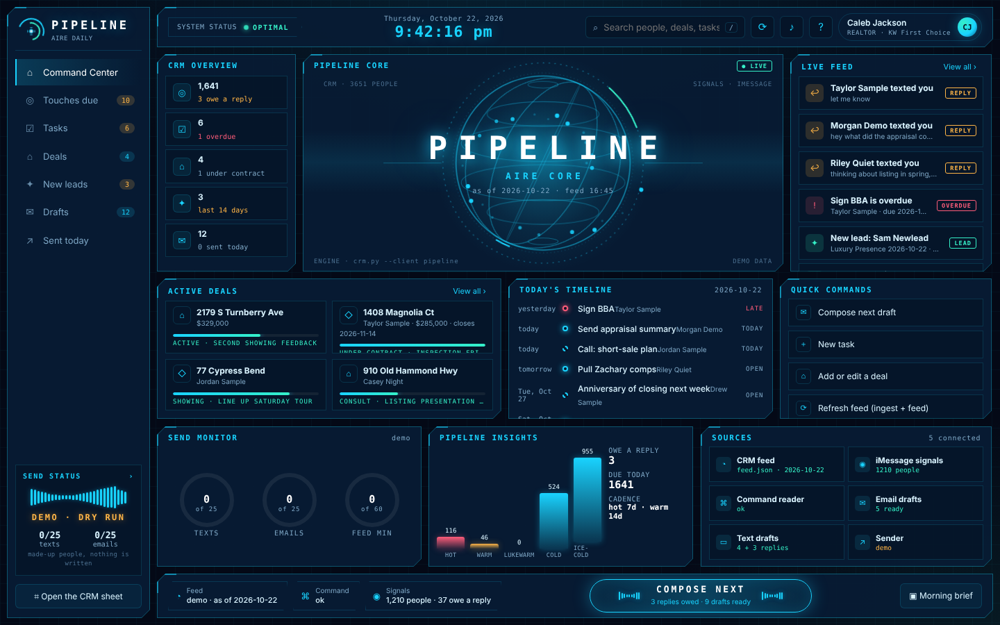

# Pipeline (Caleb's daily tool)

One screen, Jarvis style, that shows what the CRM engine in `aire/crm/` already computed and sends Caleb's actions back through `crm.py`. Rebuilt from the ground up on 2026-10-22 by Claude Code, replacing the Codex-built SwiftUI app that lived at `~/Documents/Codex/2026-10-19/task-3/PipelinePanel` on the Mac. Nothing else is to be built beside it: improve Pipeline, never a parallel dashboard (Caleb, 2026-10-19).



## What it is

- `app.py`: a Python server with no dependencies beyond the standard library. It reads the feed and the draft queues, serves the screen on `http://127.0.0.1:4747/`, and is the only thing that calls `crm.py`. It keeps the send log, runs the Do Not Contact check and enforces the daily cap.
- `static/`: the screen. Plain HTML, CSS and JavaScript, no build step, no CDN, works offline. Boot sequence, rotating core, gauges, staggered panel reveals, a compose drawer that slides in from the right.
- `predraft.py`: the step `aire/crm/refresh_feed.sh` runs after every feed rebuild. It turns `feed.json` into the text and email drafts the compose box shows, using the one drafting library in `aire/follow-up/`.
- `fixtures/`: made-up people for `--demo`, so the app can be tried and screenshotted without the real CRM.
- `launchd/` and `install.sh`: start the server at login and put a Pipeline app in the Dock that opens the screen as its own window.

## Build and run

There is no build. On the Mac, from `~/Caleb-s-Agents`:

```
# try it with made-up people first
python3 aire/pipeline-app/app.py --demo

# the real feed (rebuild it first if it is stale)
sh aire/crm/refresh_feed.sh
~/.aire/venv/bin/python aire/pipeline-app/app.py
```

The browser opens on `http://127.0.0.1:4747/`. Stop it with Ctrl-C.

To have it there every morning:

```
sh aire/pipeline-app/install.sh
```

That loads the LaunchAgent `org.calebjackson.aire.pipeline` (server at login, kept alive, log in `~/.aire/logs/pipeline.log`) and creates `~/Applications/Pipeline.app`, which opens the screen in a Chrome app window. Drag it to the Dock. `sh aire/pipeline-app/install.sh --remove` takes both away.

Checks: `python3 aire/pipeline-app/app.py --test` runs 27 offline checks (demo writes, the three send gates, the HTTP layer, the `crm.py` contract).

### Environment

| Variable | Default | What it does |
|---|---|---|
| `PIPELINE_PORT` | `4747` | Port on 127.0.0.1. The server never listens on any other interface. |
| `PIPELINE_PYTHON` | `~/.aire/venv/bin/python` if it exists | Python used to run `crm.py`. That venv has the Sheets credentials and Full Disk Access, so the app itself needs neither. |
| `PIPELINE_SENDER` | `dry` | `live` sends for real: texts through Messages, email through Gmail. Anything else logs the send and sends nothing. The screen says which mode it is in. |
| `PIPELINE_MAX_TEXTS`, `PIPELINE_MAX_EMAILS` | `25` | Daily caps, counted from `out/send-log.json` in Central time. |

`install.sh` writes these into the LaunchAgent with `PIPELINE_SENDER=dry`. Flip it to `live` in `~/Library/LaunchAgents/org.calebjackson.aire.pipeline.plist` and reload when you are ready to send from the app.

## What the app reads

All paths relative to `aire/`. Every one of these files is git-ignored and stays on the Mac: they hold client names, phones and message text.

| File | Written by | What the app shows from it |
|---|---|---|
| `crm/feed.json` | `crm/refresh_feed.sh` (LaunchAgent `org.calebjackson.aire.feed`, every 15 minutes and at login), which runs `crm.py feed --signals ../enrichment/out/imessage-signals.json` | Touches due (owes-a-reply first, then hot, then signal score, then longest silence), open tasks, live deals, new leads of the last 14 days, counts, `header_ok`. Spec: `crm/FEED.md`. |
| `follow-up/out/text-queue.json` | `pipeline-app/predraft.py` (run by `refresh_feed.sh`), or `follow-up/followups.py --queue` | Text drafts in the compose box, one per phone-only person who is due. `reply_first` entries carry the person's last three texts instead of a template. |
| `follow-up/out/email-queue.json` | same | Email drafts in the compose box for people with an email. |
| `command-reader/out/status.json` | `command-reader/command_reader.py` (LaunchAgent `org.calebjackson.aire.command`, every 30 minutes) | `{"at", "state", "detail"}`. On `login needed` or `layout changed` the status chip turns amber, the bell counts it and the Sources panel names it. |

When `feed.json` says `header_ok: false`, the app shows the HEADER CHANGED stop screen and nothing else, because the Contacts header lost a column the engine needs (`crm/FEED.md`). When `feed.json` is missing it says so and offers the refresh. When it is older than an hour the feed gauge turns red.

## What the app sends back

Every write is one shell call to `aire/crm/crm.py` with `--json --client pipeline` (verified in `app.py`, class `EngineCRM`). The engine prints exactly one JSON object (`{"ok": true, "result": ...}` or `{"ok": false, "error": ...}`), applies the write gates (person_id must exist, Do_Not_Contact only ever to YES, Command_ID never written) and logs the write to `audit.jsonl` and the Connector Log tab with `pipeline` in the Client column. A refused write shows as a red toast with the engine's reason. Nothing is retried on its own.

| In the app | Command |
|---|---|
| "Touched" on a person, and after every real send | `crm.py --json --client pipeline touch <person_id> "<what happened>"` |
| "Done" on a task with a `task_id` | `crm.py --json --client pipeline done <task_id>` |
| "Done" on a Next_Action row (no `task_id`) | `crm.py sync-tasks`, then `crm.py feed`, then `done` on the id the fresh feed carries |
| New task (Quick command, or ＋ Task on a person) | `crm.py --json --client pipeline task <person_id> "<task>" --due YYYY-MM-DD` |
| Add or edit a deal | `crm.py --json --client pipeline deal "<street>" --stage ... --price ... --close ... --next-step ... --event ... --expect <current stage> [--create --side buyer|seller]` |
| Note on a person | `crm.py --json --client pipeline note <person_id> "<text>"` |
| Do Not Contact (one way, asks for a reason) | `crm.py --json --client pipeline dnc <person_id> --reason "<why>"` |
| Refresh | `sh crm/refresh_feed.sh` on the Mac (signals, feed, predrafts), `crm.py ingest` then `crm.py feed` elsewhere. Runs in the background; the screen reloads when it finishes. |

`stage` is wired in the server (`/api/stage`) but has no button yet: stage changes come through the deal editor or the sheet.

## Sending

Pipeline is the one sender (Caleb, 2026-10-20). Every send from the compose box goes through three gates in `app.py`, in this order, and stops at the first one that fails:

1. **Do Not Contact.** A dry-run `touch` through the engine's own gate. The engine refuses a DNC person, so the send is refused with the engine's reason. No write happens.
2. **Daily cap.** Texts and emails are counted separately from `out/send-log.json` for today, Central time. The 26th is refused and the toast says so.
3. **Sender mode.** `PIPELINE_SENDER=live` sends: a text through Messages (`osascript`, the body passed as an argument so quotes are safe), an email through the Gmail token in `aire/follow-up/` using that library's one send function. Any other value logs a `dry-run` entry and sends nothing.

After a real send the engine logs it with `touch`, so the person drops off tomorrow's list. The Sent today view and the Send monitor gauges read the same log. A person already in today's log is hidden from the queue.

`followups.py --approve` stays a dry run unless `FOLLOWUP_SENDER=followups` is set on purpose, so nobody gets two messages from two places.

## The screen

| View | Key | What is on it |
|---|---|---|
| Command Center | `1` | CRM overview, the rotating core, live feed (replies owed, overdue, new leads, deal events, hot people), active deals with stage bars, today's timeline, quick commands, send gauges, band chart, sources. |
| Touches due | `2` | Every due row with band, reply flag, next action and their last text. Buttons: Compose, Touched, Task, Note, DNC. Filters: all, owe a reply, hot, warm. |
| Tasks | `3` | Overdue first. Done on each. Next_Action rows are marked and synced on Done. |
| Deals | `4` | Live deals by street with stage, price, close, next step and last event. Edit opens the deal editor. |
| New leads | `5` | Last 14 days with source and next action. |
| Drafts | `6` | The compose queue in order: replies owed first, then texts, then emails. |
| Sent today | `7` | The send log for today. |

`c` opens the next draft, `r` refreshes, `/` searches, `Esc` closes. The big COMPOSE NEXT pill at the bottom does what `c` does. Morning brief summarizes replies owed, overdue tasks, new leads, deals and today's draft counts, and starts the first reply.

## Screenshots

Taken from `--demo` on 2026-10-22 at 1440 by 900. Every person in them is made up (`fixtures/`).

| | |
|---|---|
| [Command center](screenshots/00-command-center.png) | [Touches due](screenshots/01-touches-due.png) |
| [Tasks](screenshots/02-tasks.png) | [Deals](screenshots/03-deals.png) |
| [New leads](screenshots/04-new-leads.png) | [Compose, text reply with their last three texts](screenshots/05-compose-text.png) |
| [Compose, email draft](screenshots/06-compose-email.png) | [Command login warning](screenshots/07-command-login-warning.png) |
| [Header changed stop screen](screenshots/08-header-not-ok.png) | [Drafts queue](screenshots/09-compose-queue.png) |
| [Deal editor](screenshots/10-deal-edit.png) | [Morning brief](screenshots/11-morning-brief.png) |

See `screenshots/README.md` for how they were made. Screenshots of the real feed never go in: run `python3 tools/check-no-client-data.py` before every push and look at every PNG by eye, the checker cannot see a name inside an image.

## Not verified yet (needs the Mac)

Built and tested in a Linux cloud session against the fixtures. These three paths run only on macOS and have not been exercised:

- `PIPELINE_SENDER=live` text sending through Messages. The AppleScript targets the iMessage account's participant by phone number. First real send: pick yourself.
- `PIPELINE_SENDER=live` email sending through the Gmail token in `aire/follow-up/`.
- Refresh from the screen, which runs `sh crm/refresh_feed.sh` and reads the last line of `~/.aire/logs/feed.log` for the toast.

`install.sh` and the LaunchAgent follow the same pattern as `org.calebjackson.aire.feed` but were written here, not run on the Mac.

## The old Codex app

The SwiftUI app Codex built on 2026-10-19 is not in this repo and is no longer referenced by `refresh_feed.sh` once `predraft.py` is here. Its `Sources/predraft.py` did the same job as `predraft.py` above. The folder can stay on the Mac or be deleted, and the `pipeline-airdrop.zip` in Drive (230 MB) is not needed.
